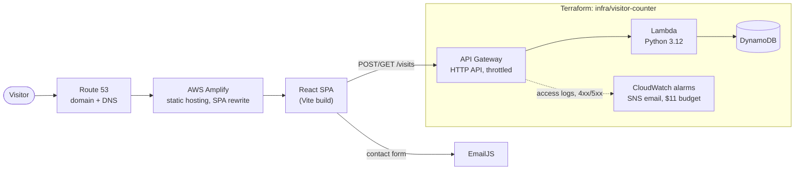

# marcbastien.com

The source for my portfolio, [marcbastien.com](https://www.marcbastien.com). I'm a cloud, DevOps and AI engineer: six years keeping enterprise systems running on AWS and Azure. I'm now building MyAutoTab end to end with an agentic workflow, and my goal is AI product engineering. The site holds my projects and experience, long-form guides and short memos. This repo also shows how I build with an AI coding agent: the plans, skills and hooks behind the site are all here.

## The story
- **Aug–Sep 2023, v1.** Hand-built React components on Create React App, a Swiper carousel and an EmailJS contact form.
- **Sep 2024.** Refocused on cloud development.
- **May 2026.** Repositioned for sysadmin and cloud engineer roles ([plan](docs/plans/2026-05-20-sysadmin-reposition.md)).
- **Nov 2026, v2.** Rebuilt with Claude Code: a new design, routing, guides and memos, a Terraform-managed visitor counter, then a move from CRA to Vite and React 19 and the workflow tooling in this repo.

The dated detail is in the [build log](docs/build-log.md).

## How I build
Spec → checkpointed plan → tests → hooks → my review.

- Every multi-part change starts as a written plan in [`docs/plans/`](docs/plans/), with the decisions steelmanned (chosen, over what, because, trade-off) and a verification gate per checkpoint.
- The agent writes code against tests. Hooks enforce what a script can check, skills cover the judgment calls, and nothing ships without my review.
- I use AI for speed, but never at the cost of security or review. The order is security, then quality, then speed.

## Architecture

Only the visitor counter is managed by Terraform. Route 53 and Amplify are set up in the console, and the Amplify rewrite rules are versioned in [`infra/amplify/redirects.json`](infra/amplify/redirects.json).

## Stack
| Layer | What |
|---|---|
| Frontend | React 19, `react-router` 7, Vite 8 |
| Tests | Vitest and React Testing Library; `node:test` for the tooling; `unittest` for the Lambda |
| Hosting | AWS Amplify, with Route 53 for the domain |
| Visitor counter | API Gateway HTTP API, Python 3.12 Lambda, DynamoDB, Terraform ([details](infra/visitor-counter/README.md)) |
| Contact form | EmailJS from the browser, with a honeypot against naive bots ([details](src/components/contact/README.md)) |
| Workflow | Claude Code, project skills, pre-commit and pre-push hooks, gitleaks |

## Run it locally
Node 24.15 or later. `.npmrc` sets `engine-strict`, so npm refuses older versions.

| Command | What it does |
|---|---|
| `npm install` | Install dependencies and point git at the repo's hooks |
| `npm start` | Dev server at http://localhost:3000 |
| `npm run test:once` | Run the tests once (`npm test` for watch mode) |
| `npm run test:security` | Tests for the vuln-check scanner and the hooks |
| `npm run build` | Lint (zero warnings allowed), then the production build into `build/`. Amplify runs the same command |
| `npm run preview` | Serve `build/` at http://localhost:3000 |

Set `REACT_APP_VISITOR_API_URL` at build time to show the visitor counter. Without it, the counter stays hidden.

## Repo layout
| Path | What |
|---|---|
| `src/` | The site: `components/` for home sections, `pages/` for routes, `content/` for guides and memos |
| `infra/` | The visitor counter's Terraform, the deployer IAM policies, and the Amplify rewrite rules |
| `tools/` | The vuln-check scanner and the pre-commit checker, each with tests |
| `.githooks/` | The pre-commit and pre-push hooks |
| `.claude/` | Project skills and the Claude Code hook settings |
| `docs/` | Plans, the [runbook](docs/runbook.md) and the [build log](docs/build-log.md) |
| `CLAUDE.md` | Conventions for the agent, split into a lean root and folder-level files |

## Why this much tooling on a portfolio site?
A static site doesn't need pre-commit hooks, checkpointed plans or a security audit skill. I added them on purpose. They're a small slice of how I use Claude Code on MyAutoTab, the SaaS I'm building to production standards, where they *are* load-bearing. That repo is private and this one is public, so this is where I can show the workflow.

**What I'd add when serving clients.** Local hooks can be bypassed, so on a real team the gate is server-side:
- a protected `main`, with changes only through PRs and no admin bypass;
- CI running the same checks as the local hook, as a required status check;
- `CODEOWNERS` review on the guard rails themselves (hooks, `.claude/`, `infra/`, the lockfile);
- GitHub secret scanning with push protection, and Dependabot;
- deploys only from protected `main` after CI passes;
- the agent sandboxed, with hooks delivered as managed settings so a repo edit can't turn them off.

## Skills
I design each skill (what it's for, its rules, when not to use it) and write it with Claude Code.

| Skill | Source | Why | Instead of |
|---|---|---|---|
| `plan-refine` | Mine, adapted from the one I use on MyAutoTab | Checkpoints, so I review at each gate and each session starts small | One long agent run I only review at the end |
| `security-audit` | Mine | Repo-level checks: secrets across git history, advisories, IAM, CORS, `.gitignore`, `public/` | A diff-only review |
| `vuln-check` | Mine | Runs my AST scanner on changed JS/JSX and explains each finding | `eslint-plugin-security` or a SaaS scanner |
| `pre-commit-checklist` | Mine | The judgment calls a hook can't make | Trusting the hook alone |
| `comment-in-my-voice` | Mine | Sparse "why" comments, using only reasons on record | Generic commenting skills |
| `dedupe` | Mine | A whole-repo duplication sweep, with measured bundle sizes | `/simplify`, which only sees one diff |
| `graphify` | Third-party | A code knowledge graph, here as a measured demo (below) | Grep |
| `/simplify`, `/code-review`, `/security-review` | Built in | Diff-level review | — |

## Numbers
Measured, not claimed:
- **`CLAUDE.md`: 3.1k → 1.2k tokens per session (−61%).** I split it into a lean root plus folder files that load only when the agent works there.
- **The hooks refused every bypass in the test matrix.** Testing found two more (an abbreviated `--no-veri`, a `core.hooksPath` change chained before a commit), and both are fixed. The limits that remain, like a nested shell, are [documented](docs/plans/2026-11-05-claude-workflow/cp3b.md#d4-local-hooks-are-the-demo-a-production-gate-would-be-server-side-decided-2026-11-06-marc), and the server-side list above is how I'd close them.
- **graphify: −0.5% tokens over 3 questions, all answered correctly both ways.** I wouldn't run a code graph on a site this small. It's here to show the install, the review of the hooks it adds, and an honest measurement. The savings come on large codebases with agents working across them.

See the visual version: https://www.marcbastien.com/guides/how-i-build-with-ai-agents

## License
© Marc Bastien. The code is all rights reserved. The guides are licensed CC BY 4.0, as noted on each guide.
